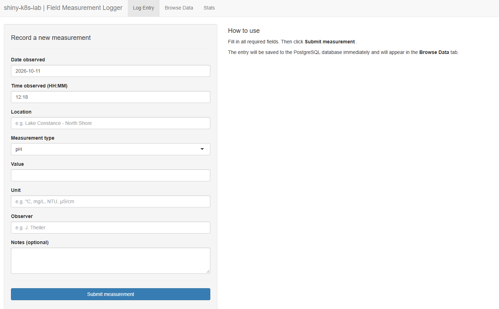

# shiny-k8s-lab

A learning project: I'm a data scientist learning Kubernetes, Docker and CI/CD,
and I wanted to learn them on a "real" example rather than a hello-world container.

The example is a small R Shiny app backed by PostgreSQL. This repo takes it all the way
from a Docker image to a running deployment on a local Kubernetes cluster (minikube),
with a GitHub Actions pipeline that builds and publishes the image.

It's written from a data scientist's perspective — if you work in R and want to see
what it takes to get an app from your laptop into Kubernetes, this might help you too.

---

## What this project builds

A **Field Measurement Logger** — a web app for logging environmental measurements
(location, type, value, unit, observer, notes). It has three tabs:

- **Log Entry** — a form to record a new measurement
- **Browse Data** — a filterable table of all entries
- **Stats** — summary statistics and a boxplot per measurement type



Shiny and PostgreSQL are a common pairing for data scientists in industry, which makes
them a realistic example to deploy.

| Component | Technology |
|---|---|
| App | R Shiny |
| Database | PostgreSQL 15 |
| Containerisation | Docker |
| Orchestration | Kubernetes (minikube) |
| CI pipeline | GitHub Actions — builds the image on pushes to `main` that change `app/` |
| Image registry | GitHub Container Registry (ghcr.io) |

### How the parts connect

```
code in app/ ──push──► GitHub Actions ──builds image──► ghcr.io
                                                           │
                                                           │ pulled on pod start
                                                           ▼
browser ──port-forward──► Shiny pod ──SQL──► PostgreSQL pod ──► persistent volume
                          └──────────── minikube cluster ─────────────┘
```

1. Code changes in `app/` are pushed to GitHub.
2. GitHub Actions builds a Docker image and pushes it to ghcr.io.
3. Kubernetes pulls the image when the Shiny pod starts (`kubectl rollout restart` after a new build).
4. The Shiny pod reaches PostgreSQL through a Service, using credentials from a Secret.
5. PostgreSQL stores its data on a persistent volume, so it survives pod restarts.

---

## Repository structure

```
.
├── .github/
│   └── workflows/
│       └── build-and-push.yml   # CI: builds and pushes the Shiny Docker image
├── app/
│   ├── Dockerfile               # Shiny app container definition
│   ├── global.R                 # Database connection pool, shared config
│   ├── ui.R                     # Shiny user interface
│   └── server.R                 # Shiny server logic (insert + query measurements)
├── docs/
│   └── screenshot.png           # App screenshot used in this README
├── k8s/
│   ├── 00-namespace.yaml        # Kubernetes Namespace (isolated workspace)
│   ├── postgres/
│   │   ├── 01-secret.yaml       # DB credentials (demo values, base64-encoded — not encrypted)
│   │   ├── 02-pvc.yaml          # Persistent storage for DB data
│   │   ├── 03-deployment.yaml   # PostgreSQL Deployment + init.sql schema (ConfigMap;
│   │   │                        #   runs only once, on an empty database)
│   │   └── 04-service.yaml      # Internal DNS name for the DB
│   └── shiny/
│       ├── 05-configmap.yaml    # Non-sensitive app configuration
│       ├── 06-deployment.yaml   # Shiny app Deployment (imagePullPolicy: Always, so
│       │                        #   `kubectl rollout restart` picks up new CI builds)
│       ├── 07-service.yaml      # Internal DNS name for the Shiny app
│       └── 08-ingress.yaml      # External HTTP access via hostname
└── README.md                    # You are here
```

The `00-` … `08-` prefixes reflect the apply order: namespace first, then the database,
then the app that depends on it.

---

## How it's built

### The database schema

*(See the `postgres-initdb` ConfigMap at the top of `k8s/postgres/03-deployment.yaml`.)*

The schema lives in a ConfigMap that is mounted into `/docker-entrypoint-initdb.d/`. The official
postgres image runs it **once**, on first start with an empty data directory — later restarts skip it.

The schema defines one table: `measurements`. Every field is chosen for a real field-data
collection workflow:

| Column | Type | Purpose |
|---|---|---|
| `id` | SERIAL PRIMARY KEY | Auto-incrementing unique identifier |
| `observed_at` | TIMESTAMPTZ | Timestamp with timezone — critical for field data |
| `location` | TEXT | Site name or GPS description |
| `measurement_type` | TEXT | What was measured (pH, temperature, etc.) |
| `value` | NUMERIC | The numeric reading |
| `unit` | TEXT | Unit of measure (°C, mg/L, NTU, etc.) |
| `observer` | TEXT | Who collected the data |
| `notes` | TEXT | Free-text remarks |

The script also inserts 5 sample rows dated 2026-09-01. The Browse Data tab shows the last
30 days by default, so set the start date earlier to see them.

### The R Shiny app (`app/`)

*(See `app/global.R`, `app/ui.R`, `app/server.R` for the full files with comments.)*

- `global.R` — runs once at startup and opens the database connection pool
- `ui.R` — the layout of the three tabs
- `server.R` — inserts new measurements and queries them for the table and stats

The app contains **no credentials**. `global.R` reads `DB_HOST`, `DB_PORT`, `DB_NAME`, `DB_USER`
and `DB_PASSWORD` from environment variables, and Kubernetes fills them in from the ConfigMap
and the Secret. That's the link between the R code and the cluster: the same code runs
anywhere, only the configuration around it changes.

The connection uses a **connection pool** (`pool` package), so multiple concurrent users share
connections efficiently without reconnecting on every query.

### The Dockerfile (`app/Dockerfile`)

*(See `app/Dockerfile` for the full file with comments.)*

Based on `rocker/shiny:latest`. Installs the PostgreSQL client library and all required R packages.

You don't build this image yourself — GitHub Actions does (see Step 4). The R packages are
installed *before* the app code is copied in, so Docker can reuse the cached package layer:
a change to `ui.R` rebuilds in about a minute instead of about ten.

### The Kubernetes manifests (`k8s/`)

*(See each file in `k8s/` for the full manifests with comments.)*

Once deployed, the `field-logger` namespace contains only **two pods** — PostgreSQL and Shiny.
Everything else (Services, ConfigMaps, the Secret, the PersistentVolumeClaim, the Ingress)
is configuration around them, not running processes — see
[Key Kubernetes concepts](#key-kubernetes-concepts-used) for what each one does.

The cluster's own components run as pods in other namespaces (`kube-system`, and
`ingress-nginx` if the addon is enabled). `kubectl get pods -A` shows all of them.

---

## Prerequisites

- [Docker](https://docs.docker.com/get-docker/) (Docker Desktop on Mac/Windows, Docker Engine on Linux)
  — Docker Desktop must be **running** before you start minikube
- [minikube](https://minikube.sigs.k8s.io/docs/start/) — on Windows: `winget install Kubernetes.minikube`
- [kubectl](https://kubernetes.io/docs/tasks/tools/) — already included in Docker Desktop;
  only Linux users need to install it separately
- A GitHub account (free tier is sufficient — needed only if you want to push your own image via CI)

minikube runs the cluster with 2 CPUs and about 4 GB of RAM, so make sure that much is free.

```bash
git clone https://github.com/jonastheiler/shiny-k8s-lab.git
cd shiny-k8s-lab
```

---

## Step-by-step setup

### Step 1 — Start the Kubernetes cluster

```bash
# Start a local single-node cluster, using Docker to run the node
minikube start --driver=docker

# Verify the cluster is running — you should see one node with status Ready
kubectl get nodes
```

Expected output:
```
NAME       STATUS   ROLES           AGE   VERSION
minikube   Ready    control-plane   1m    v1.x.x
```

*Optional:* `minikube addons enable ingress` installs an Ingress controller. It's only needed if
you want to try the Ingress route in Step 3 — the main path uses `kubectl port-forward`.

**What just happened?** The `minikube` container you now see in Docker Desktop *is* your
cluster: the whole Kubernetes node runs inside that one container, and your app's pods run
inside it (that's why they don't show up as separate containers in Docker Desktop).

Manage it with minikube — **not** from Docker Desktop. Deleting or resetting the container
there leaves minikube in a broken state.

| Command | Effect |
|---|---|
| `minikube stop` | Shuts the cluster down, keeps all data |
| `minikube start` | Brings the same cluster back |
| `minikube delete` | Removes the cluster and all its data |

---

### Step 2 — Deploy to the cluster

```bash
# Apply all manifests in order
kubectl apply -f k8s/00-namespace.yaml
kubectl apply -f k8s/postgres/
kubectl apply -f k8s/shiny/

# Watch Pods come up — wait until both show 1/1 Running (Ctrl+C to exit)
kubectl get pods -n field-logger -w
```

Expected output once ready:
```
NAME                         READY   STATUS    RESTARTS   AGE
postgres-xxx                 1/1     Running   0          60s
shiny-app-xxx                1/1     Running   0          60s
```

The first start takes a minute or two — the Shiny image is pulled from ghcr.io.

If a pod doesn't reach `Running` (e.g. `ImagePullBackOff`, `CrashLoopBackOff`), these two
commands usually show why:

```bash
kubectl describe pod <pod-name> -n field-logger   # events: scheduling, image pull, probes
kubectl logs <pod-name> -n field-logger           # the container's own output
```

---

### Step 3 — Access the app

```bash
# Forward the Shiny service to port 8080 (keep this terminal open)
kubectl port-forward svc/shiny-service 8080:80 -n field-logger
```

Open **http://localhost:8080** in your browser.

A port-forward is tied to the pod that was running when you started it. After a pod is
replaced (e.g. `kubectl rollout restart` in Step 4), stop it and start it again.

**Try it out:**
1. **Log Entry** — submit a new measurement.
2. **Browse Data** — find it in the table. Set the start date before 2026-09-01 to also see
   the 5 sample rows.
3. **Stats** — check the summary table and the boxplot.

**Known issue:** the Refresh button on Browse Data doesn't re-query the database. New entries
appear after you change a filter (e.g. the date range).

**Optional — try the Ingress instead of port-forward.** `08-ingress.yaml` routes the hostname
`field-logger.local` to the Shiny service. It needs the ingress addon from Step 1. With
minikube's Docker driver:

1. Run `minikube tunnel` in a separate terminal and keep it open.
2. Add `127.0.0.1 field-logger.local` to your hosts file
   (`C:\Windows\System32\drivers\etc\hosts` on Windows, `/etc/hosts` on macOS/Linux; needs admin rights).
3. Open **http://field-logger.local**. If Chrome won't resolve `.local` names, try another browser.

**Look into the database.** For a quick look, open `psql` inside the Postgres pod — no
database client needed, works on every OS:

```bash
kubectl exec -it -n field-logger deploy/postgres -- psql -U fielduser -d fielddb
# then e.g.:  SELECT * FROM measurements;   quit with \q
```

To connect from a client like DBeaver, read the credentials from the Secret and forward the port:

```bash
# Decode credentials from the Secret (macOS/Linux/Git Bash)
kubectl get secret postgres-secret -n field-logger -o jsonpath='{.data.POSTGRES_USER}' | base64 -d
kubectl get secret postgres-secret -n field-logger -o jsonpath='{.data.POSTGRES_PASSWORD}' | base64 -d
```

```powershell
# The same in PowerShell
$pw = kubectl get secret postgres-secret -n field-logger -o jsonpath='{.data.POSTGRES_PASSWORD}'
[Text.Encoding]::UTF8.GetString([Convert]::FromBase64String($pw))
```

```bash
# Forward the PostgreSQL port, then connect to localhost:5432 with the credentials above
kubectl port-forward svc/postgres-service 5432:5432 -n field-logger
```

---

### Step 4 — GitHub Actions CI

*(See `.github/workflows/build-and-push.yml` for the full workflow with comments.)*

On every push to `main` that touches `app/`, GitHub Actions:
1. Checks out the code
2. Logs into GitHub Container Registry (`ghcr.io`) using the built-in `GITHUB_TOKEN`
3. Builds the Shiny Docker image
4. Pushes it tagged with both `latest` and the commit SHA

Pushes that only change the README or `k8s/` don't trigger a build. To rebuild without a code
change, use the **Run workflow** button in the Actions tab.

**Two tags, two purposes:**
- `:latest` moves to every new build — the Deployment uses it.
- `:<sha>` (e.g. `:a1b2c3d`) stays fixed to one commit forever — useful for knowing exactly
  what runs, and for rollbacks.

**Example — fixing a typo in the app:**

1. Fix the typo in `app/ui.R`, commit and push to `main`.
2. Watch the run in the repo's **Actions** tab. A green check means the new image is on ghcr.io.
   Thanks to the layer cache, this takes about a minute.
3. Tell the cluster to pick it up, and wait until it's done:
   ```bash
   kubectl rollout restart deployment/shiny-app -n field-logger
   kubectl rollout status deployment/shiny-app -n field-logger
   ```
4. Restart the port-forward (it was tied to the old pod) and reload http://localhost:8080.

**Why the restart is needed:** the YAML didn't change, so Kubernetes sees nothing to do on its
own. `rollout restart` creates a new pod, and `imagePullPolicy: Always` makes it pull the new
`:latest`. The old pod is only stopped once the new one is ready — no downtime.

**Rolling back:** because the image tag stays `:latest`, `kubectl rollout undo` would just pull
the newest image again. To go back to an earlier version, point the Deployment at its SHA tag:

```bash
kubectl set image deployment/shiny-app shiny-app=ghcr.io/jonastheiler/shiny-k8s-lab:<sha> -n field-logger
```

**CI is automatic, CD is manual — and why.** Building the image happens automatically, but
deploying it is the `rollout restart` you run yourself: GitHub's servers can't reach a cluster
running on your laptop. In production, a tool like **Argo CD** or **Flux** runs *inside* the
cluster, watches Git or the registry, and deploys new versions on its own. Production setups
also usually pin SHA tags in the manifests instead of `:latest`, so every deployment is traceable.

---

## Key Kubernetes concepts used

| Concept | What it does in this project |
|---|---|
| **Pod** | The actual running unit — one for PostgreSQL, one for Shiny. Everything else exists to run, configure or connect pods |
| **Namespace** | Groups all resources for this app; prevents conflicts with other workloads. A way of grouping, **not** a security boundary |
| **Secret** | Stores the PostgreSQL user and password; passed to the pods as env vars — never in the app code. Only base64-encoded, not encrypted |
| **ConfigMap** | Stores the DB hostname and port; can change without rebuilding the image |
| **PersistentVolumeClaim** | Requests durable storage; PostgreSQL data survives Pod restarts |
| **Deployment** | Declares desired state; restarts Pods automatically if they crash |
| **ReplicaSet** | Created by a Deployment, one per version of the pod template — each `rollout restart` adds a new one and scales the old one to 0 |
| **Liveness / readiness probes** | Liveness restarts a hung container; readiness decides when a pod gets traffic. Readiness is why a rollout has no downtime: the old pod stops only once the new one is ready |
| **Service (ClusterIP)** | Gives the DB and Shiny app stable internal DNS names within the cluster |
| **Ingress** | Routes external HTTP requests to the Shiny service by hostname. Only a *rule* — the ingress-nginx controller (minikube addon, own namespace) does the actual routing |
| **Port-forward** | Not a resource but a `kubectl` feature: tunnels a local port to a Service or pod. The main way into the cluster in this lab |

---

## Lessons learned

- **s6-overlay and Renviron.site**: The `rocker/shiny` image uses `s6-overlay` as PID 1. Its `01_set_env` init script writes Kubernetes environment variables (DB_HOST, DB_PORT, etc.) into `/usr/local/lib/R/etc/Renviron.site` so R can read them via `Sys.getenv()`. Without `chmod 666` on that file the script silently skips the variables and `dbPool()` tries to connect via Unix socket instead of TCP.

- **Ingress addon**: Must be enabled before applying the Ingress manifest, or the Ingress will have no address.

- **minikube's container and volume must stay in sync**: The node's `/etc` lives in the `minikube` container, its `/var` (etcd, certificates, database data) in a Docker volume of the same name. I hit two errors when they got out of sync: `certificate … signed by unknown authority` (a leftover volume from an old cluster) and a kubelet that wouldn't start (the container had been deleted outside minikube). Both were fixed by `minikube delete` followed by `minikube start`.

- **"The database is empty" — but it wasn't**: The app showed no data, but the rows were there — the Browse tab's default date filter hid them. Check the data where it lives (`kubectl exec … psql`) before debugging the app.

- **`:latest` makes rollbacks hard**: `kubectl rollout undo` doesn't help when the image tag never changes — the pod just pulls the newest image again. Immutable SHA tags are what make rollbacks possible.

- **The init script runs only once**: PostgreSQL runs the schema script only on an empty data directory. Changing the schema or seed data later means deleting the volume (and its data) — or writing a migration.

---

## Author

Jonas Theiler — senior data scientist learning cloud-native deployment patterns.
